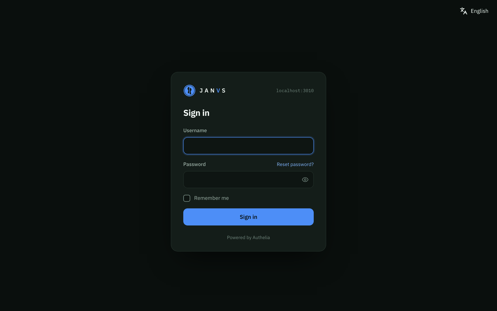
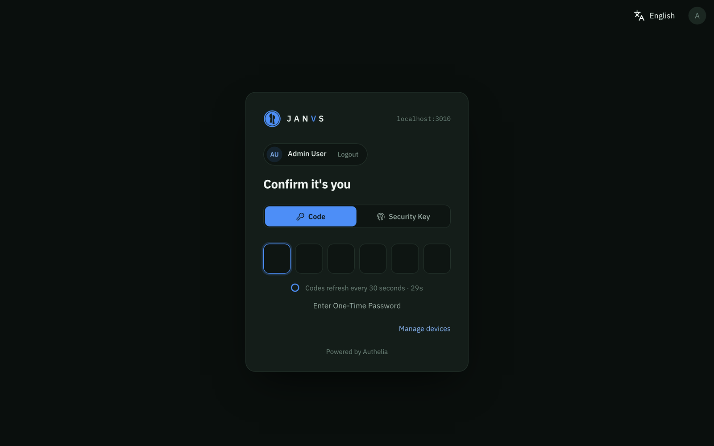
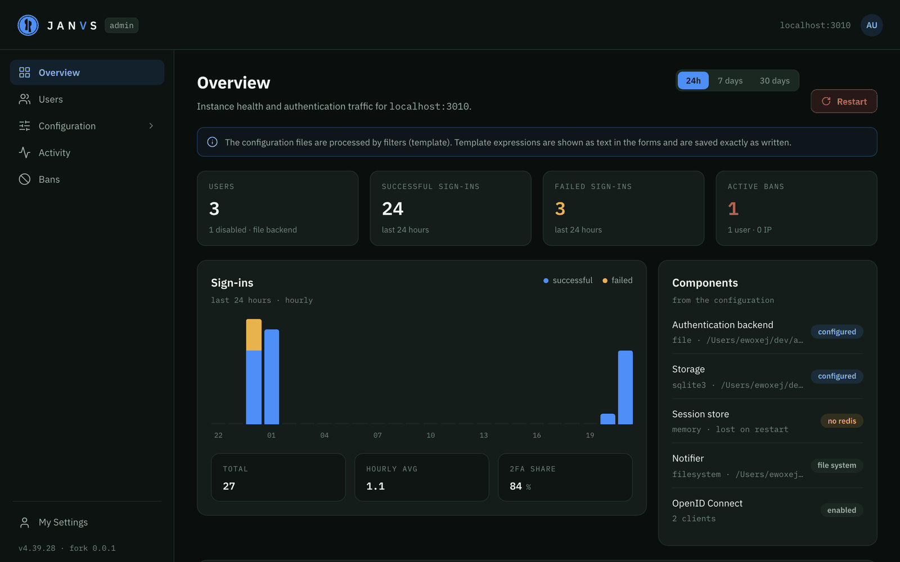
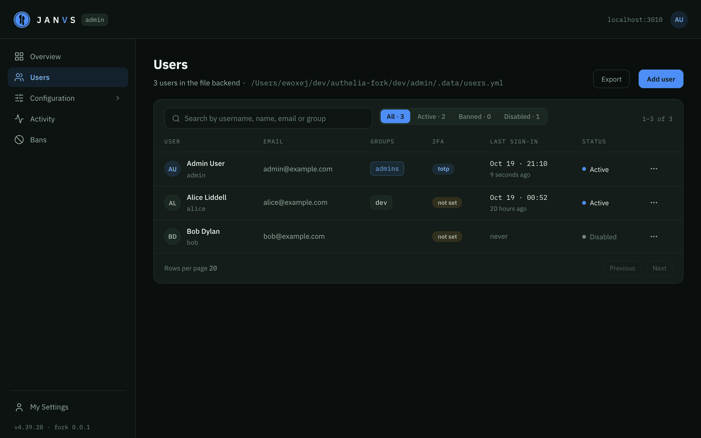
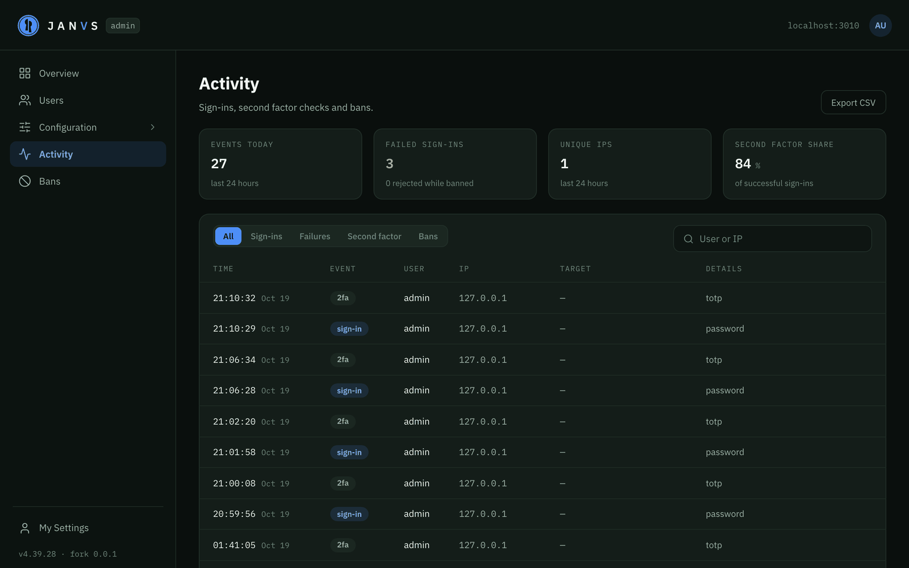
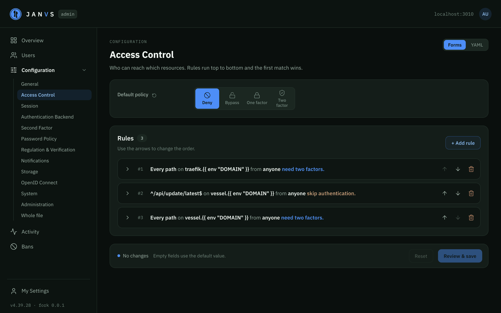
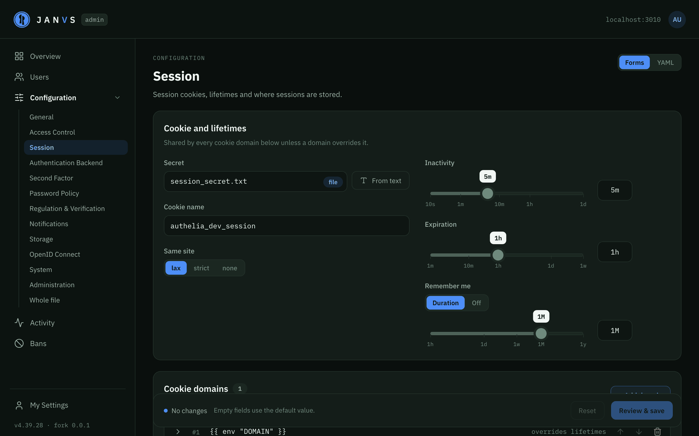
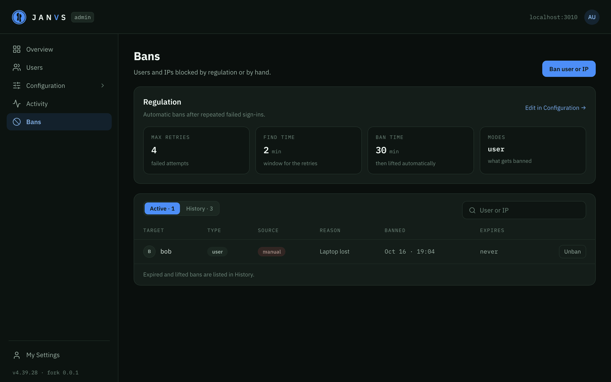
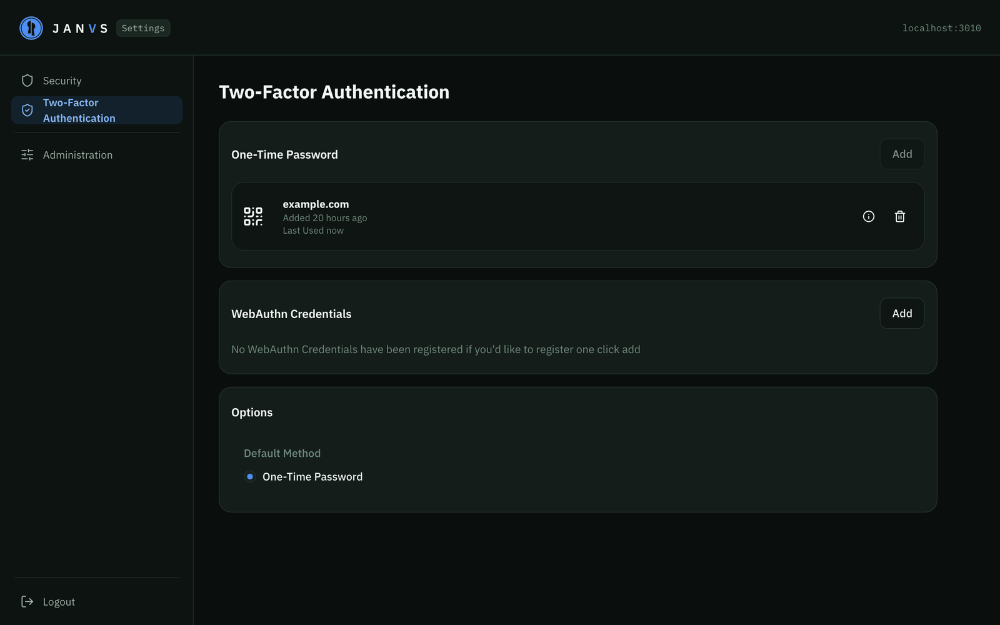

<p align="center">
  
</p>

<h1 align="center">JANVS</h1>

<p align="center">
  An authentication and authorization server with a web administration area, based on
  <a href="https://github.com/authelia/authelia">Authelia</a>.
</p>

**Janus** is a fork of [Authelia](https://github.com/authelia/authelia) v4.39.28. It keeps everything Authelia does
(single sign-on and two-factor authentication for applications behind a reverse proxy, OpenID Connect, access control)
and adds a web interface for running it: users, configuration, sign-in activity and bans can be managed from the
browser instead of editing YAML files by hand. The sign-in pages and user settings were redesigned to match.

The configuration format is the same as Authelia's, so an existing Authelia configuration works as is and the
[Authelia documentation](https://www.authelia.com/configuration/prologue/introduction/) applies to everything except the
additions below.

## Screenshots

### Sign in

<p align="center">
  
  
</p>

### Administration

<p align="center">
  
</p>

<p align="center">
  
  
</p>

<p align="center">
  
  
</p>

<p align="center">
  
  
</p>

## What's different from Authelia

### Administration area

Available at `/admin` to members of the administrator group.

- **Overview**: sign-ins over the last 24 hours, 7 or 30 days, user and ban counts, and the state of the configured
  components (authentication backend, storage, session store, notifier, OpenID Connect).
- **Users** (file authentication backend): create, edit, disable and delete users, set passwords, manage groups, remove
  second factor devices, ban, and see each user's sign-in history.
- **Configuration**: forms for every section (access control rules, session, authentication backend, second factor,
  password policy, regulation, notifications, storage, OpenID Connect and more) plus a YAML editor for the whole file.
  - Changes are validated before they're written, and Janus restarts itself to apply them.
  - Template expressions such as `{{ env "DOMAIN" }}` and `{{ secret "/secrets/key" }}` are kept exactly as written.
  - A file picker for paths, which can also create folders and generate secret files.
- **Activity**: sign-in attempts, second factor checks and bans with filters, search and CSV export.
- **Bans**: ban and unban users and IP addresses, with the history of expired bans.

Opening the administration area requires a recent second factor: signing in with it counts, and after the elevation
lifespan the second factor is asked for again.

### Sign-in pages and user settings

- New design for the sign-in, second factor, password reset and consent pages.
- The user settings (password, one-time password, security keys and passkeys) use the administration design.
- After signing in without a redirect, users land on their settings.
- Light, dark, grey and OLED themes, following the `theme` option.

## Enabling the administration area

```yaml
administration:
  enabled: true
  # Members of this group can use the administration area. Default: admins.
  admin_group: 'admins'
  # Directories the file picker can browse. Default: the directories of the configuration files.
  file_roots:
    - '/config'
    - '/secrets'
  # Don't restart after configuration changes; they're applied on the next manual restart.
  disable_restart: false
```

Administrators must have a second factor configured. The configuration files have to be writable by the process for
the configuration forms to save.

## Running in Docker

The image runs Janus as the user `1000:1000`, not as root. On start it changes the owner of `/config` to that user so the
administration area can save the configuration and the users file. Set `PUID` and `PGID` to use another user, or start
the container with `--user`, in which case nothing is changed and the mounted files have to be readable and writable by
that user already.

Files outside `/config`, such as secrets mounted elsewhere or the directories in `file_roots`, have to be readable by the
user, and writable where the administration area creates folders or secret files.

## Development

[dev/admin](dev/admin/README.md) has a development environment with hot reload: it builds the backend, seeds test
users and starts the web interface on http://127.0.0.1:3010.

```bash
./dev/admin/run.sh
```

## License

Janus is licensed under the [Apache 2.0](LICENSE) license, as is Authelia. It's an independent fork and isn't
affiliated with or endorsed by the Authelia project. Authelia is developed by the
[Authelia contributors](https://github.com/authelia/authelia/graphs/contributors).
